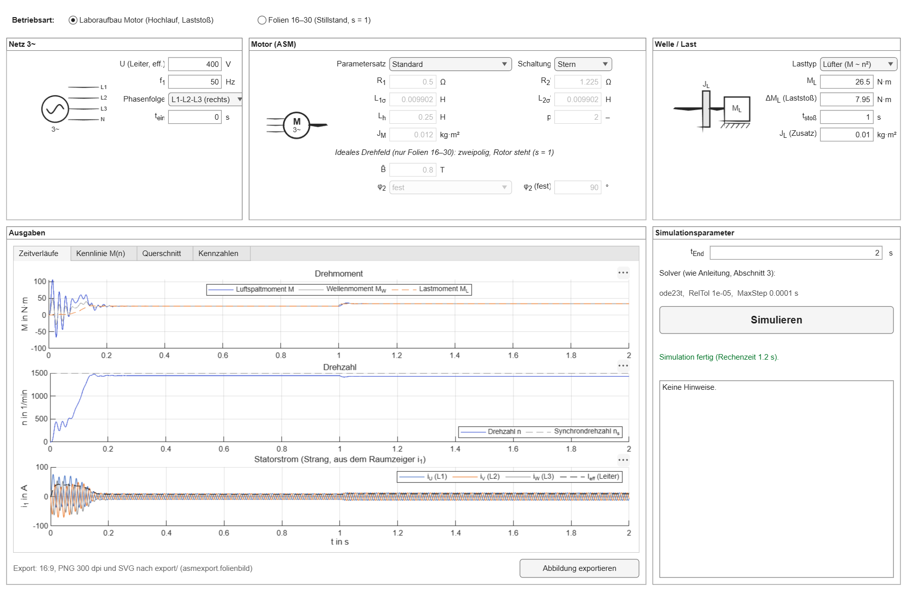

# Anleitung: ASM-Bausteinbibliothek

Bausteinbibliothek zur Simulation des Drehstrom-Asynchronmotors (Käfigläufer) – Seminararbeit
Elektrotechnik, DHBW Mannheim. Der Motor wird wie im Labor zusammengesteckt:
Netz → Messgeräte → Motor → Welle → Last.

> Alle Standardwerte sind **Beispielwerte** eines fiktiven 4-kW-Motors (`parameter/asm_standard.m`),
> keine Datenblattwerte.

## 1 Schnellstart

Voraussetzungen: MATLAB, Simulink, Simscape, Simscape Electrical (entwickelt mit R2026b, Ziel R2023b
oder neuer, siehe Abschnitt 9). Ein C-Compiler wird nicht gebraucht.

```matlab
cd <Projektordner>/asm_bausteine
startup_asm          % Pfade setzen
build_library        % Bibliothek erzeugen (lib/, etwa 5 s)
baue_beispiele       % Beispielmodelle erzeugen (beispiele/)
asm_bausteine_lib    % Bibliothek öffnen
```

Im Library Browser erscheint der Eintrag **„ASM-Bausteine (Drehstrom-Asynchronmotor)“** (ggf. im
Library Browser mit F5 aktualisieren). `lib/` wird von `build_library` vollständig neu erzeugt –
dort nichts von Hand ändern.

## 1a Bedienoberfläche

Wer nur simulieren und auswerten will, braucht keine Masken und keinen Bus Selector:

```matlab
startup_asm          % Pfade setzen (Bibliothek und Beispiele müssen erzeugt sein, siehe oben)
ASMApp               % Bedienoberfläche öffnen
```



Das Fenster folgt dem Aufbau im Labor von links nach rechts: **Netz 3~ | Motor (ASM) | Welle/Last**,
darunter **Ausgaben** und **Simulationsparameter**. Jeder Bereich zeigt ein Schaltbild-Symbol, die
Eingabefelder (mit Einheit) stehen daneben. Wertebereiche kommen aus dem Bausteinkatalog
(`+asmbib/katalog.m`); ungültige Eingaben (z. B. R1 ≤ 0, p nicht ganzzahlig, J_L = 0) lehnt schon
das Feld ab, der Tooltip nennt den Bereich.

**Betriebsarten** (oben). Nicht benötigte Felder sind ausgegraut.

| Betriebsart | Grundlage | Eingaben |
|---|---|---|
| Laboraufbau Motor | `beispiele/bsp_hochlauf_laststoss.slx` | Netz U, f1, Phasenfolge, t_ein; Motor: Parametersatz (bei „Standard“ gesperrt, Werte aus `asm_standard.m`), Stern/Dreieck, R1, L1σ, Lh, R2′, L2σ′, p, J_M; Last: Lasttyp (konstant oder Lüfter) mit M_L, Laststoß ΔM_L und t_stoß (ΔM_L = 0: kein Laststoß), Zusatzträgheit J_L |
| Folien 16–30 (Stillstand, s = 1) | `beispiele/bsp_folien16_30_rotorstab.slx` | f1, B̂, φ2 (fest oder aus der Rotorimpedanz 90° + φZ); zweipolig, zwei Stäbe |

Lüfterlast: M_L ist das Moment bei der Bezugsdrehzahl n_B = 0,96·n_s (Beispielmotor 1440 1/min).

**Ausgaben** (Tabs):

1. **Zeitverläufe** – Labor: M(t) (Luftspalt-, Wellen- und Lastmoment), n(t), Strangströme i_U, i_V,
   i_W (aus dem Raumzeiger i1) und I_eff. Folien: B⊥ (rot) und Stabstrom (blau) wie Folie 16,
   Kräfte auf Stab 1 und 2, Schleifenmoment M_S.
2. **Kennlinie M(n)** – dynamischer Verlauf, Lastkennlinie, stationäre ESB- und Kloss-Kennlinie mit
   den aktuellen Werten (`asmbib.kennlinie_bild`).
3. **Querschnitt** – Rotorquerschnitt im Folienstil (`asmbib.querschnitt`): Stromrichtung (• / ×),
   Feldzeiger, B⊥/B∥, Änderungsvektor, Kraftpfeile; Zeitschieberegler, ▶ (Abspielen/Anhalten),
   Zeitlupe, Ansicht rotor- oder statorfest.
4. **Kennzahlen** – Labor: n_s, n, s, M und I am Ende (Mittel der letzten 5 %), Anzugs- und
   Kippmoment, Kippschlupf (stationär aus dem T-ESB – das dynamische Moment beim Einschalten enthält
   Pendelmomente), größtes dynamisches Moment. Folien: î_Stab, B̂, φ2, φZ, mittleres M_S.

**Abbildung exportieren** speichert die Abbildung des aktiven Tabs mit `asmexport.folienbild`
(16:9, PNG 300 dpi und SVG) als `export/asmapp_<betriebsart>_<tab>.*`.

**Simulieren** sperrt die Oberfläche bis zum Ende der Rechnung (Laboraufbau 2 s Simulationszeit: einige
Sekunden). Status- und Fehlermeldungen stehen unter dem Knopf, darunter Hinweise zur Plausibilität
(z. B. Dreieckschaltung an 400 V, f1 ≠ f_N, Laststoß nach t_End).

**Rechenkern ohne Oberfläche:** Die App ruft nur `asmapp.simuliere` auf; das geht auch direkt:

```matlab
P = asmapp.standardwerte('labor');            % asm_standard + Netz, Last, Simulation
P.parametersatz = 'Benutzerdefiniert';  P.R2b = 1.8;
E = asmapp.simuliere('labor', P);             % 'labor' | 'folien'
plot(E.zeit.t, E.zeit.n), E.kennzahlen
```

Die Beispielmodelle werden dabei **nicht verändert**: Parameter gehen über
`Simulink.SimulationInput` (`setBlockParameter`) an die Masken, der Messbus des Motors wird über
`SimulationInput.LoggingSpecification` zusätzlich protokolliert; es gibt kein `save_system`.
Der Schlupf wird aus n und der Netzfrequenz f1 berechnet (das Element `s` des Messbusses bezieht sich
auf die Bemessungsfrequenz f_N der Motormaske).

## 2 Bausteine

| Gruppe | Bausteine |
|---|---|
| Quellen | Netz 3~ (Phasenfolge, Nullphasenwinkel, Einschaltzeitpunkt, Innenimpedanz), Sternpunkt (Erde) |
| Maschine | **ASM Standard** (kompakt), zerlegt: Klemmbrett (Stern/Dreieck), Stator, Luftspalt-Drehfeld, Käfigläufer |
| Mechanik | Schwungmasse, Welle elastisch, Last konstant, Last Lüfter, Last Kennlinie, Laststoß, Reibung, Mechanischer Bezug |
| Messgeräte | Amperemeter, Voltmeter, Strommessung 3~, Spannungsmessung 3~, Leistungsmesser 3~, Drehmomentmesswelle, Drehzahlmesser, Luftspalt-Sonde, Schreiber |
| Didaktik | Ideales Drehfeld, Rotorstab-Sonde, Drehfeld-Anzeige, Spulenfelder, Kennlinienschreiber |
| Referenz | ASM Referenz (Simscape Electrical), ASM Kloss (quasistationär), Leiterschleife (Prototyp Teil A) |

Jeder Baustein hat eine Maske mit Einheiten, Wertebereichsprüfung und Hilfe (Gleichungen, Quelle).
Doppelklick auf **ASM Standard**: Parametersatz „Standard“ (Felder gesperrt) oder
„Benutzerdefiniert“. Mit Ctrl+U sieht man den zerlegten Motor.

## 3 Ein Modell aufbauen

1. **Netz 3~** und **Sternpunkt (Erde)** an n, dazu eine **Solver Configuration**
   (Simscape › Utilities) an denselben Knoten.
2. Netzleiter a, b, c – optional über **Leistungsmesser 3~** und **Strommessung 3~** (in Reihe) – an
   a, b, c von **ASM Standard**. **Spannungsmessung 3~** und **Voltmeter** parallel anschließen.
3. Welle R des Motors → **Drehmomentmesswelle** → Wellenknoten. Am Wellenknoten: **Schwungmasse**
   (Trägheit der Last), Lasten (R an die Welle, C an den Bezug), **Drehzahlmesser** (R an die Welle,
   C an den Bezug).
4. Gehäuse C des Motors und alle C-Anschlüsse an **Mechanischer Bezug**.
5. Solver: `ode23t`, Relative Toleranz `1e-5`, maximale Schrittweite `1e-4` s.

Fertige Aufbauten: `beispiele/bsp_hochlauf_laststoss.slx` (Laboraufbau mit allen Messgeräten),
`beispiele/bsp_vergleich_modelle.slx` (ASM Standard, Referenz und Kloss nebeneinander).

**Messbus:** Der Ausgang „Mess“ von ASM Standard ist ein Simulink-Bus mit i1, u1, psi_h, phi_el,
Bhat, i_mu, i2b, M, n, Om, th_mech, theta2, s (Bus Selector verwenden).

## 4 Didaktik: Folien 16–30 im Modell

- `beispiele/bsp_folien16_30_rotorstab.slx`: zweipoliges **Ideales Drehfeld**, Rotor steht (s = 1),
  φ2 = 90°, Leiterschleife aus zwei Stäben – genau die Situation der Folien 16–30. Die
  **Rotorstab-Sonde** liefert B⊥, Stabströme, Kräfte, Momente.
- Nach der Simulation: Doppelklick auf **Drehfeld-Anzeige** → Knopf **„Animation zeigen“**.
  Darstellung wie in den Folien: U1 oben, Feld im Uhrzeigersinn, rot • = Strom aus der
  Zeichenebene, blau × = hinein, grüner Feldzeiger, roter Anteil B⊥, grün gestrichelt B∥,
  dunkelroter Änderungsvektor, blaue Kraftpfeile.
- `beispiele/bsp_rotorstab_motor.slx`: dieselben Bausteine am echten Motor (4-polig, 28 Stäbe),
  dazu Spulenfelder und **Kennlinienschreiber** (Knopf „Kennlinie zeichnen“).
- Drehfeld-Anzeige und Kennlinienschreiber protokollieren nach `out.drehfeld_anzeige` bzw.
  `out.kennlinie` – je Modell nur **ein** Baustein dieser Art.

## 5 Folienbilder exportieren

```matlab
folienbilder                    % alle Folienbilder nach export/ (etwa 1 min)
validierung_motor               % Validierungsbilder und Kennzahlen nach export/
```

Eigene Abbildungen im einheitlichen Stil (16:9, Schrift ≥ 14 pt, PNG 300 dpi und SVG):

```matlab
asmexport.folienbild(gcf, 'mein_bild')                     % Abbildung
asmexport.modellbild('bsp_hochlauf_laststoss', 'aufbau')   % Modellansicht
D = asmbib.drehfeld_daten(out.get('drehfeld_anzeige'));    % Querschnitt bei festen Feldwinkeln
par = struct('p',1,'N2',2,'l',0.15,'r',0.06,'N1xi1',144,'k1',1,'k2',2,'lage1',-pi/2);
asmexport.querschnitt_serie(D, par, 'Winkel', 0:30:360)    % folie18 ... folie30
```

Linien mit „L1“, „L2“, „L3“, „Stab 1“, „Stab 2“ im DisplayName erhalten feste Farben
(`'Farben', false` schaltet das ab).

## 6 Prüfen

```matlab
runtests('tests')     % 64 Tests (davon 10 für die Bedienoberfläche), etwa 2 min
```

Kommandozeile: `matlab -batch "startup_asm; runtests('tests')"`. Ergebnisse und Befunde der
Validierung: [VALIDIERUNG.md](VALIDIERUNG.md).

## 7 Typische Fehler

| Meldung / Verhalten | Ursache und Abhilfe |
|---|---|
| „Each physical network must be connected to exactly one Solver Configuration block“ | Solver Configuration fehlt (oder zwei an einem Netz) |
| Simulation hängt an einem Zeitpunkt | Sprung oder unstetige Funktion im Modell (z. B. PS Step, Simulink-Sprung mit Filter am Netz). Die Bibliotheksbausteine sind ereignisfrei; Laststoß-Baustein verwenden |
| Wert wird in der Maske abgelehnt | Wertebereich (Hilfe des Bausteins zeigt alle Grenzen) |
| „J_M muss > 0 sein“ | Motorträgheit nicht null setzen; Lastträgheit über Schwungmasse |
| Drehfeld-Anzeige: „Keine Simulationsdaten“ | erst simulieren; Ergebnis muss in `out` liegen (Standard bei Simulink) |
| Spannungsmessung 3~ mit Bezug „Anschluss n“ meldet singuläres System | Anschluss n ist nicht angeschlossen |

## 8 Ordner

| Ordner / Datei | Inhalt |
|---|---|
| `+asmlib/` | Simscape-Quellen (.ssc): Domäne `luftspalt`, Quellen, Maschine, Mechanik, Messgeräte, Referenz |
| `+asmbib/` | Bausteinkatalog (`katalog.m`), Stil, Masken, Prüfstand, Rotorstab-Formeln, Didaktik |
| `+asmexport/` | folienbild, modellbild, querschnitt_serie |
| `+asmapp/` | Rechenkern der Bedienoberfläche: simuliere, standardwerte, grenzen, pruefe |
| `ASMApp.m` | Bedienoberfläche (programmatische App-Klasse, Abschnitt 1a) |
| `lib/` | **generiert**: `asm_bausteine_lib.slx`, `asmlib_lib.slx` |
| `parameter/` | Parametersätze (`asm_standard.m`) |
| `beispiele/` | Beispielmodelle und Skripte (baue_beispiele, folienbilder, validierung_motor) |
| `tests/` | matlab.unittest-Tests |
| `doku/` | SPEC, KONVENTIONEN, VALIDIERUNG, diese Anleitung |
| `export/` | erzeugte Folienbilder |

Neuen Baustein anlegen: [KONVENTIONEN.md](KONVENTIONEN.md), Abschnitt 7.

## 9 Kompatibilität

- Entwickelt und getestet mit **R2026b**. Ein Test mit R2023b steht aus (nicht installiert).
- Die erzeugten `.slx`-Dateien (Bibliothek, Beispiele) haben das R2026b-Format und lassen sich in
  älteren Releases nicht öffnen. Dort einfach `build_library` und `baue_beispiele` ausführen – beide
  erzeugen alles neu aus den Quellen.
- Release-abhängige Stellen haben Rückfallwege: `sscbuild` (ab R2024b) → `ssc_build`;
  `exportgraphics(..., 'Padding', 'figure')` (neuere Releases) → `print`; Farbschemata (`theme`,
  ab R2025a) werden in älteren Releases übersprungen.
- Statische Durchsicht der übrigen Funktionen: alle seit R2022a oder früher verfügbar.
- Bedienoberfläche: uifigure, uigridlayout, uiaxes, HTML-Beschriftungen (`uilabel` mit
  `Interpreter`, ab R2021a), `Simulink.SimulationInput` mit `LoggingSpecification`; `theme` wird wie
  oben übersprungen. Ein Test der App mit R2023b steht ebenfalls aus.
