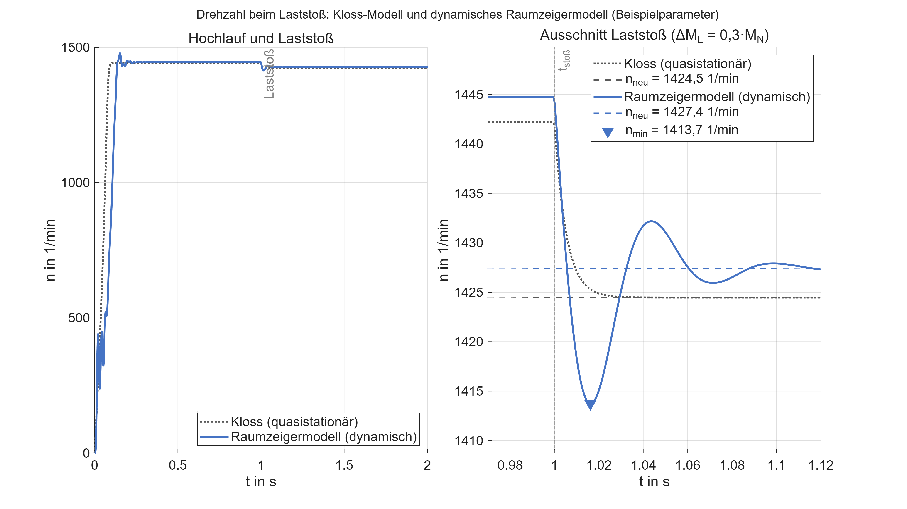

# Modellprüfung der ASM-Bausteinbibliothek: Testfälle, Konsistenzprüfungen, Modellbenchmark

Stand: 26.11.2026 (Abschlussreview). Getestet ausschließlich mit MATLAB R2026b Update 1, Simulink 26.2,
Simscape 26.2, Simscape Electrical 26.2 unter Windows 11 (ANLEITUNG, Abschnitt 9).

> Alle Parameter sind Beispielwerte (`parameter/asm_standard.m`), keine Datenblatt- oder Messwerte.
>
> **Einordnung:** Die Prüfungen in diesem Dokument sind von vier Arten, die nicht vermischt werden:
> 1. **Analytische Konsistenzprüfung** – Simulation gegen eine Rechnung aus denselben Gleichungen
>    und Parametern (Teil A gegen î2·l·B̂·r·sin φ2, Teil B gegen den Schnittpunkt der Kennlinien,
>    dynamisches Modell gegen das T-ESB, Schleife gegen Kloss).
> 2. **Implementierungsvergleich** – dieselbe Gleichung, zwei Lösungswege (Simscape-Kloss-Baustein
>    gegen ode45).
> 3. **Modellbenchmark** – zwei unabhängig implementierte Modelle mit denselben Annahmen und
>    Parametern (ASM Standard gegen Simscape Electrical).
> 4. **Experimentelle Validierung** – gegen Messungen an einem realen Motor. **Liegt nicht vor.**
>
> Eine Prognosegüte für einen realen Motor ist damit nicht belegt. Der Dateiname „VALIDIERUNG“ ist
> historisch.

## 0 Laufprotokoll der Abschlussprüfung

Alle Angaben in diesem Abschnitt stammen aus tatsächlich ausgeführten Läufen am 26.11.2026 auf
diesem Rechner. Frühere Angaben (z. B. „73/73“) sind keine Nachweise dieses Stands.

| Merkmal | Wert |
|---|---|
| Release | MATLAB 26.2.0.3433840 (R2026b) Update 1, PCWIN64 (Windows 11) |
| Toolboxen | Simulink 26.2, Simscape 26.2, Simscape Electrical 26.2 |
| Sitzung | frische MATLAB-Sitzung über `matlab -batch` (leerer Base Workspace, Pfade nur über `startup_asm`) |

Ablauf in der frischen Sitzung (Skript des Reviews, gleichwertig von Hand ausführbar):

```matlab
startup_asm; build_library; build_examples          % 32 Bausteine, 6 Beispielmodelle neu erzeugt
R = run_asm(asm_params('kloss'));                    % ebenso 'loop', 'lab', 'slides'
app = ASMApp('Visible', false); app.simulate();      % Oberfläche separat (unsichtbar)
check_asm('Log', 'check_asm.log')                    % Unit-Tests + verify_asm, Fehler bei Nichtbestehen
```

| Lauf | Ergebnis |
|---|---|
| `run_asm('kloss')` | 2,9 s Rechenzeit; t(0,9·n_N) = 77,01 ms; n_vor 1442,206, n_min 1424,467, n_neu 1424,467 1/min (erwartet 1442,206 / 1424,467); Einschwingzeit 13,02 ms; Modell unverändert |
| `run_asm('loop')` | s = 0,2, 2 Rotorperioden; M̄_S = 5,110 714 N·m (analytisch 5,110 714 N·m); Modell unverändert |
| `run_asm('lab')` | 1,7 s; t(0,9·n_N) = 125,43 ms; n_vor 1444,773, n_min 1413,733, n_neu 1427,421 1/min (ESB 1444,780 / 1427,431); Einschwingzeit 55,95 ms; Modell unverändert |
| `run_asm('slides')` | î_Stab = 2784,1 A, M̄_S = 20,046 N·m, φ2 = 90,00°; Modell unverändert |
| Folgeläufe (kloss: Standard, dann ΔM_L = 0,5·M_N und J_L = 0,03, dann wieder Standard) | n_neu 1424,467 / 1411,805 / 1424,467 1/min; dritter Lauf bitgleich mit dem ersten; `R.params` zeigt die geänderten Werte |
| `run_asm('lab')` mit „custom“, R2′ = 1,8 Ω | n_neu 1397,29 1/min (ESB-Erwartung 1397,31), `R.params.R2b` = 1,8 |
| Oberfläche (unsichtbar) | Labor: n_end 1427,42 1/min; Entlastung ΔM_L = −0,3·M_N: n_max 1475,49 1/min, Überschwingen 14,56 1/min; Folien: î_Stab 2784,1 A |
| `check_asm` | **96 von 96 Unit-Tests bestanden** (AppTest 10, BenchmarkTest 8, DidacticsTest 6, ExamplesTest 6, ExportTest 8, LibraryTest 15, MechanicsTest 7, SourcesSensorsTest 6, SpeedMetricsTest 17, TechnicalCasesTest 13); `verify_asm`: 16 bestanden, 3 Info, 0 nicht bestanden/Fehler/nicht verfügbar/abgewählt; Exit-Code 0 |
| Fehlererkennung im Batch | `matlab -batch "startup_asm; verify_asm('Tests', 'B1', 'TimeOut', 1e-3, 'ErrorOnFailure', true)"`: beide B1-Zeilen „Fehler“ („Abbruch (asm:simulation): … Zeitgrenze TimeOut“), 16 Zeilen „abgewählt“, 1 Info; Abbruch mit `asm:verify`, **Exit-Code 1** |
| Wiederholung `check_asm` (nach Korrektur des Versionsprotokolls) | 96 von 96 Unit-Tests bestanden; `verify_asm` 16 bestanden, 3 Info; Simscape Electrical 26.2 im Protokoll; **Exit-Code 0** |
| Folienbilder neu erzeugt in einen Prüfordner: `export_slide_figures('Folder', ordner)`, `benchmark_motor('Folder', ordner)` | beide ohne Fehler (38 bzw. 8 Dateien); PNG-Vergleich mit `export/`: **22 von 23 pixelgleich**; `folie16_verlaeufe.png` weicht in 760 verstreuten Pixeln (0,0084 %) ab, die zugrunde liegenden `run_asm`-Daten sind bitgleich → Unterschied der Rasterung, nicht der Daten; `export/` deshalb nicht überschrieben |
| Oberfläche sichtbar (`ASMApp('Visible', true)`), Bildschirmfotos aller vier Reiter mit `exportapp` | Labor (Belastung und Entlastung ΔM_L = −7,95 N·m) und Folien: alle Achsen, Legenden und Tabellenzeilen deutsch beschriftet; Entlastung zeigt „maximale Drehzahl nach der Entlastung“ 1475 1/min, „Drehzahlanstieg“ 16,16 1/min, „Überschwingen“ 14,56 1/min; Folien: Mittelwertlinie M̄_S = 20,05 N·m im Momentenverlauf; keine Hinweise, keine Fehlermeldungen. Bemerkt, aber als bestehendes GUI-Verhalten nicht geändert: Kennzahlentabelle mit Dezimalpunkt (wie die Eingabefelder); φ_Z im Folienmodus als −3,553e−13° (Rundungsrest von φ2 − 90°) |
| Abschluss-`check_asm` in frischer Batch-Sitzung nach den letzten Änderungen (Option `'Folder'` in `benchmark_motor`, Dokumentation) | 96 von 96 Unit-Tests bestanden; `verify_asm` 16 bestanden, 3 Info, 0 nicht bestanden/Fehler/nicht verfügbar/abgewählt; **Exit-Code 0** |

Nicht ausgeführt: Test in R2023b oder anderen Releases (nicht installiert); Bedienung der
Oberfläche mit Maus und Tastatur (die Sichtprüfung oben setzt Eingaben programmgesteuert); Ersetzen
der Dateien in `export/` (nicht nötig, siehe Folienbilder-Zeile).
Nachholen in R2023b: `matlab -batch "startup_asm; check_asm('Build', true, 'Log', 'check_asm_R2023b.log')"`
in einer Kopie des Ordners (die erzeugten `.slx` werden dabei überschrieben).

## 1 Fachliche Testfälle Teil A und Teil B (`verify_asm`)

Alle Läufe über `run_asm` und die Beispielmodelle `ex_conductor_loop` (Teil A), `ex_kloss_startup`
(Teil B) und `ex_startup_load_step` (dynamisches Modell). Abweichung = Ist − Soll; Toleranz absolut
in derselben Einheit.

| Test | Art | Größe | Soll | Ist | Abweichung | Toleranz | Status |
|---|---|---|---|---|---|---|---|
| A1 | analytisch | s = 0: max. Rotorstrom \|i_k\| | 0 A | 0 A | 0 | 1e-9 A | bestanden |
| A1 | analytisch | s = 0: max. Schleifenmoment \|M_S\| | 0 N·m | 0 N·m | 0 | 1e-9 N·m | bestanden |
| A2 | analytisch | s = s_N = 0,04: mittleres Schleifenmoment (2 Rotorperioden) | 1,965 66 N·m | 1,965 66 N·m | 5e-13 N·m | 1e-6 relativ | bestanden |
| A3 | analytisch | s = s_K = 0,2: mittleres Schleifenmoment | 5,110 71 N·m | 5,110 71 N·m | −4e-14 N·m | 1e-6 relativ | bestanden |
| A4 | analytisch | s = 1: mittleres Schleifenmoment | 1,965 66 N·m | 1,965 66 N·m | −2e-14 N·m | 1e-6 relativ | bestanden |
| A5 | Konsistenz | N_S·M̄_S(s_K) = MK | 71,55 N·m | 71,55 N·m | −5e-13 N·m | 1e-6 relativ | bestanden |
| B1 | analytisch | stationäre Drehzahl nach dem Hochlauf (Kloss ∩ Lüfterlast) | 1442,206 1/min | 1442,206 1/min | −7e-12 1/min | 0,15 1/min | bestanden |
| B1 | Implementierung | Hochlaufzeit bis 0,9·n_N = 1296 1/min | 77,006 ms | 77,006 ms | 1e-7 s | 0,1 ms | bestanden |
| B2 | – | vor dem Laststoß eingeschwungen (max. Abweichung im Fenster) | 0 | 1,7e-9 1/min | 1,7e-9 1/min | 1,5 1/min | bestanden |
| B2 | analytisch | Drehzahl vor dem Laststoß | 1442,206 1/min | 1442,206 1/min | −2e-11 1/min | 0,15 1/min | bestanden |
| B2 | analytisch | minimale Drehzahl nach dem Laststoß | 1424,467 1/min | 1424,467 1/min | 7e-12 1/min | 0,15 1/min | bestanden |
| B2 | analytisch | Drehzahleinbruch n_vor − n_min | 17,739 1/min | 17,739 1/min | −2e-11 1/min | 0,3 1/min | bestanden |
| B2 | analytisch | neuer stationärer Arbeitspunkt | 1424,467 1/min | 1424,467 1/min | 8e-12 1/min | 0,15 1/min | bestanden |
| B2 | Implementierung | Einschwingzeit (Band ±1,5 1/min) | 13,020 ms | 13,020 ms | −3e-7 s | 0,1 ms | bestanden |
| Z1 | analytisch (ESB) | dyn. Modell: Drehzahl vor dem Laststoß | 1444,780 1/min | 1444,773 1/min | −0,007 1/min | 0,75 1/min | bestanden |
| Z2 | analytisch (ESB) | dyn. Modell: neuer stationärer Arbeitspunkt | 1427,431 1/min | 1427,421 1/min | −0,011 1/min | 0,75 1/min | bestanden |
| Z3 | – | dyn. Modell: Drehzahleinbruch | – | 31,04 1/min | – | – | Info |
| Z4 | – | dyn. Modell: Einschwingzeit | – | 55,95 ms | – | – | Info |
| R | – | Bemessungspunkt: Kloss-Moment bei s_N (Soll = M_N) | 26,50 N·m | 27,52 N·m | +1,02 N·m (+3,8 %) | – | Info |

Zusammenfassung: 16 bestanden, 0 nicht bestanden, 0 Fehler, 0 nicht verfügbar, 0 abgewählt, 3 Info.
Nur „bestanden“ zählt als bestanden; Info-Zeilen sind keine Prüfungen.

**Status:** „bestanden“ (|Ist − Soll| ≤ Toleranz), „nicht bestanden“ (außerhalb oder Soll/Ist nicht
bestimmbar), „Fehler“ (ausgewählter Test abgebrochen – Simulationsfehler, Zeitgrenze – mit
Fehlerkennung), „abgewählt“ (Option `Tests`), „nicht verfügbar“ (Simulink/Simscape oder erzeugte
Bibliothek/Beispiele fehlen), „Info“. Jeder Test liefert immer dieselben Zeilen, ein Abbruch
erzeugt weder Teil- noch Doppelzeilen. `verify_asm('ErrorOnFailure', true)` und `check_asm` brechen
bei „nicht bestanden“, „Fehler“ oder „nicht verfügbar“ mit Fehler ab (Exit-Code ≠ 0 in `-batch`).

Begründung der Toleranzen (vollständig in der Spalte `Begruendung` der Rückgabetabelle):

- **A, s = 0:** ohne Relativbewegung keine induzierte Spannung, Strom und Moment exakt null; es wird
  keine Rotorperiode berechnet und kein Mittelwert gebildet. Toleranz nur Rundung.
- **A, s > 0:** Sollwert analytisch M̄_S = î2·l·B̂·r·sin φ2 (`asmtools.loop_mean_torque`, SPEC 3.1).
  Mittelungsfenster: ganze Rotorperioden T2 = 1/(s·f1) bis t_End (Standard: 2 Perioden). Das
  Schleifenmodell hat keinen Einschwingvorgang (algebraisch in θ2 = s·ω1·t, keine Zeitkonstante),
  daher ist das Fenster ab t = 0 zulässig. Ohne ganze Periode gibt `run_asm` keinen Mittelwert aus
  (NaN mit Hinweis). Erwartet ist Gleichheit bis auf Rundung; 1e-6 relativ deckt die Interpolation
  zwischen Solverschritten ab.
- **A5:** Konsistenzprüfung, keine unabhängige Validierung: R2 und L2σ der Schleife sind aus MK und sK
  abgeleitet (`asmtools.loop_parameters`).
- **B, Drehzahlen:** Sollwert = stabiler, aus der Anfangsbedingung erreichbarer Schnittpunkt von
  Motor- und Lastmoment (`asmtools.operating_point`, nach dem Stoß ausgehend vom alten Arbeitspunkt),
  mit derselben geglätteten Lastkennlinie wie der Lastbaustein. Toleranz 0,15 1/min = 0,01 % von
  n_s = 1500 1/min: stationärer Endwert, Mittel über 50 ms, RelTol 1e-5, MaxStep 0,1 ms; die Glättung
  der Lüfterlast verschiebt den Schnittpunkt um weniger als 1e-6·M_B.
- **B, Zeiten:** Sollwert aus ode45 (RelTol 1e-10) für dieselbe Bewegungsgleichung mit gleicher
  Trägheit J_M + J_L, Anfangsdrehzahl 0 und gleicher Last-, Vorzeichen- und Sprungglättung, ausgewertet
  mit derselben Funktion. Das vergleicht zwei Implementierungen; die Auswertungslogik selbst prüft
  `tests/SpeedMetricsTest.m` unabhängig. Toleranz 0,1 ms = MaxStep (Schrittweitenstudie Abschnitt 3c).
- **B2, kein Unterschwingen:** nur für diesen Testfall begründet – Kloss-Modell mit starrer Welle und
  nur drehzahlabhängiger Last ist ein System 1. Ordnung, Ω strebt nach dem Stoß monoton gegen den neuen
  Arbeitspunkt. Für das dynamische Modell gilt das nicht (Z3).
- **Z:** Toleranz 0,75 1/min = 0,05 % von n_s = 1500 1/min; Modell und ESB stimmen stationär auf
  0,02 % bis 0,06 % im Moment überein (V1). Für Einbruch und Einschwingzeit des dynamischen Modells gibt
  es keinen unabhängigen Sollwert; im berechneten Verlauf liegt n_min 13,7 1/min unter dem neuen
  Arbeitspunkt (Unterschwingen), daher „Info“.

## 2 Befunde und Änderungen

### 2a Abschlussreview (26.11.2026, Vergleich mit Commit 0d5d382)

| Nr. | Befund | Ergebnis | Änderung | Nachweis |
|---|---|---|---|---|
| P0 | Begründung Z1: Wert hinter „n_s =“ ist die Toleranz | **bestätigt**, ebenso bei B1/B2 („0,01 % von n_s = 0.15 1/min“). Z3 behauptete Unterschwingen pauschal | Toleranz und n_s getrennt („Toleranz 0,75 1/min = 0,05 % von n_s = 1500 1/min“), Dezimalkomma; Z3-Text folgt dem berechneten Verlauf; Zeile R nennt ESB statt „dynamisches Modell“ | `toleranceTextsStateNsAndTolerance`, `undershootTextFollowsTrajectory` |
| P1 | `verify_asm` trennte abgewählt und abgebrochen nicht; Teilzeilen bei Abbruch | **bestätigt** (alle als „nicht ausgeführt“; bei Abbruch in Teil A wären bereits angehängte Zeilen plus fünf Ersatzzeilen entstanden) | Status „Fehler“, „abgewählt“, „nicht verfügbar“; feste Zeilen je Test; `ErrorOnFailure`; `check_asm` für Batch | `deselectedTestsAreMarked`, `abortedTestIsErrorWithoutDuplicates` |
| P1 | ode45-Vergleich prüft die Kennzahlenlogik nicht unabhängig | **bestätigt** (beide Pfade nutzen `speed_metrics`) | 17 Unit-Tests mit von Hand bestimmten Sollwerten (u. a. t = [0 1 2] s, n = [0 800 1200] 1/min, Ziel 1000 → 1,5 s) | `tests/SpeedMetricsTest.m` |
| P1 | Laststoß kurz vor Simulationsende | **bestätigt**: `n_neu` war ein Mischwert aus der Zeit vor und nach dem Stoß (Beispiel t_stoß = 1,98 s: 1436,9 1/min) | Endfenster muss vollständig nach dem Stoß liegen und von Daten abgedeckt sein, sonst NaN mit Grund | `loadStepShortlyBeforeEnd`, `endWindowTooShort` |
| P1 | Lastabwurf (ΔM_L < 0) | **bestätigt**: nur n_min/Einbruch (= 0), kein n_max | n_max, t_max, Überschwingen; Unterschwingen n_neu − n_min getrennt vom Einbruch; GUI zeigt je Richtung die passenden Größen | `loadDecrease`, `loadDecreaseInSimulation` |
| P1 | Einschwingzeit nur auf Abtastwerte bezogen | Verbesserung | Eintritt ins Band linear interpoliert, letzter Eintritt zählt | `bandEntryExitAndPermanentReentry` |
| P1 | Teil A: Mittelwert bei zu kurzer Laufzeit | **bestätigt**: t_End < T2 lieferte 1,649 statt „kein Mittelwert“ (Folien ebenso) | NaN mit Hinweis; s = 0 ohne Periode | `noPseudoValidMeans` |
| P1 | „Kein erreichbarer stabiler Arbeitspunkt“ | **bestätigt**: konstante Last 30 N·m > M_A meldete „Arbeitspunkt 1,5 1/min“ (Kriechdrehzahl der tanh-Glättung) | Stillstandszone < 4,8 1/min: `standstill`, `reachable = false`, Hinweis „läuft nicht an“ bzw. „kippt“ | `noStartIsDetected`, `operatingPointStandstill` |
| P1 | Bemessungspunkt | nachvollzogen (Abschnitt 3d), keine Parameteränderung | Unterscheidung n(M = M_N) und Arbeitspunkt mit Lüfterlast | `ratedPointFinding` |
| P2 | Abgeleitete Größen bei „custom“ | **bestätigt**: geändertes MK änderte R2_S/L2s_S der Schleife nicht | abgeleitete Größen immer neu berechnet, abweichende Eingabe mit Warnung `asm:derived` | `derivedFieldsAreRecomputed` |
| P2 | Solver-Einstellungen nicht im Parametersatz | Verbesserung | `P.max_step`, `P.rel_tol` über `SimulationInput`; `R.solver` und `R.sim_input` zeigen die übergebenen Werte | `solverSettingsArePassed`, `runAsmIsExplicit` |
| P2 | Base Workspace, Callbacks, Folgeläufe | bereits erfüllt, erneut geprüft: kein `assignin`; `evalin` nur in `asmtools.last_sim_output` (Maskenknöpfe); keine Modell-Callbacks | – | `runAsmIsExplicit`, `sequentialRunsAreIndependent`, Abschnitt 0 |
| P2 | README: „Abweichung < 0,1 %“ ohne Größe und Bezug | **bestätigt** | Größe, Bezugsgröße, Methode und Testfall angegeben (Abschnitt 4) | – |

### 2b Erste Überarbeitung (26.11.2026, Commit 0d5d382)

| Nr. | Befund der Vorprüfung | Ergebnis der Prüfung | Änderung |
|---|---|---|---|
| 1 | Bemessungspunkt: Kloss liefert bei n_N 27,52 statt 26,50 N·m | bestätigt (+3,85 %); kein Parameter geändert | MK, sK zentral in `asm_standard.m`; `asmtools.rated_point` |
| 2 | Lauf ohne GUI, SimulationInput, Callbacks, `assignin`/`evalin` | teilweise bestätigt (Kern mit SimulationInput gab es; implizite Maskeninitialisierung) | `run_asm(P)`, `asm_params`, Motor immer „Benutzerdefiniert“ |
| 3 | „90 % des letzten Simulationswerts“ | in dieser Bibliothek nicht vorhanden (Prototyp) | feste Kennzahlen (`asmtools.speed_metrics`) |
| 4 | drei fachliche Testfälle | Teil A war nur bei s_K geprüft | `verify_asm` |
| 5 | Aussagekraft, Referenz, Version | „validiert“ zu stark; Widerspruch R2023b/R2026b bestätigt | Formulierungen, Kompatibilitätsabschnitt |
| – | Test `libraryBrowser` scheiterte am Ordnernamen | bestätigt | Test prüft den Projektpfad |

## 3 Einordnung

### 3a Kopplung der Modellteile je Szenario

| Szenario (`run_asm`) | Modell | Schlupf/Drehzahl | Rückwirkung auf die Mechanik | Bemerkung |
|---|---|---|---|---|
| `'loop'` (Teil A) | `ex_conductor_loop` | Schlupf als **Konstante** `P.s_loop` | **keine** – es gibt keine Mechanik | übernimmt den Schlupf nicht aus Teil B; einseitig koppelbar über `P.s_loop = R_B.metrics.s_end` |
| `'kloss'` (Teil B) | `ex_kloss_startup` | Drehzahl aus J·dΩ/dt = M_Kloss − M_L | Kloss-Moment treibt die Welle | kein Schleifenmoment beteiligt, keine elektrische Dynamik |
| `'lab'` | `ex_startup_load_step` | aus dem Raumzeigermodell | Luftspaltmoment des Raumzeigermodells | Leiterschleife nicht beteiligt; Stabströme nur als Darstellung (Rotorstab-Sonde, Querschnitt) |
| `'slides'` | `ex_slides16_30_rotor_bars` | kinematisch vorgegeben, s = 1 (Rotor steht) | keine | ideales Drehfeld + Rotorstab-Sonde |

Die Übereinstimmung N_S·M̄_S(s) = M_Kloss(s) zwischen Teil A und Teil B ist eine
**Konsistenzprüfung** der Herleitung (Schleifenwerte aus MK und sK), keine unabhängige Validierung.

### 3b Abdeckung der früheren Validierungs-Testsuite

Die alte `ValidierungTest` (Stand vor 0d5d382) ist vollständig in `BenchmarkTest` enthalten; nichts ist
verloren gegangen.

| Prüfung (alt) | aktueller Test | Art |
|---|---|---|
| V1 stationäre Kennlinie gegen T-ESB | `BenchmarkTest/V1_stationaryCharacteristicLikeEC` | analytische Konsistenz |
| V2 Hochlauf + Laststoß gegen Simscape Electrical | `BenchmarkTest/V2_runUpLikeReference` | Modellbenchmark |
| V3 Bemessungsbetrieb gegen Kloss und n_N | `BenchmarkTest/V3_ratedOperationLikeKloss` | Konsistenz (1 % von n_s) |
| V4 Rotorstabmomente: Σ M_k = M, Schleife = 2/N2·M | `BenchmarkTest/V4_rotorBarSumEqualsTorque` | analytische Konsistenz |
| V5 Leerlauf, Kippmoment | `BenchmarkTest/V5_noLoadAndBreakdownTorque` | analytische Konsistenz |
| V6 Energiebilanz | `BenchmarkTest/V6_energyBalance` | Konsistenz (Bilanz) |
| V7 Kloss-Baustein gegen ODE | `BenchmarkTest/V7_klossBlockLikeODE` | Implementierungsvergleich |
| V8 Stern/Dreieck | `BenchmarkTest/V8_deltaLikeStar` | Konsistenz |

### 3c Schrittweitenstudie (Begründung der Toleranzen)

| MaxStep | Kloss: t(0,9·n_N) | Kloss: Einschwingzeit | dyn. Modell: n_vor | dyn. Modell: n_neu | dyn. Modell: Einbruch |
|---|---|---|---|---|---|
| 0,2 ms | 77,006 3 ms | 13,019 7 ms | 1444,769 1/min | 1427,415 1/min | 31,05 1/min |
| 0,1 ms (Standard) | 77,006 1 ms | 13,020 1 ms | 1444,773 1/min | 1427,421 1/min | 31,04 1/min |
| 0,05 ms | 77,006 0 ms | 13,020 4 ms | 1444,778 1/min | 1427,429 1/min | 31,03 1/min |

Die Zeiten des Kloss-Falls ändern sich um weniger als 1 µs (Toleranz 0,1 ms), die Drehzahlen des
dynamischen Modells um etwa 0,01 1/min je Halbierung (Toleranz 0,75 1/min). Restwelligkeit in den
Mittelungsfenstern (50 ms vor dem Stoß und am Ende): max. Abweichung vom Mittelwert jeweils
< 0,001 1/min bei beiden Modellen.

### 3d Bemessungspunkt

Mit den aktuellen Standardwerten (n_s = 1500 1/min, n_N = 1440 1/min, s_N = 0,04, MK = 71,55 N·m,
sK = 0,2): M_Kloss(s_N) = 27,52 N·m statt M_N = 26,50 N·m (+3,8 %); wegen s_N = sK² gilt
M_Kloss(s_N) = M_Kloss(1). Zu unterscheiden:

| Größe | Kloss | T-ESB (dynamisches Modell stationär) |
|---|---|---|
| Drehzahl, bei der das Motormoment M_N erreicht | 1442,4 1/min | 1445,2 1/min |
| Arbeitspunkt mit der angesetzten Lüfterlast (M_B = M_N bei n_B = n_N) | 1442,2 1/min | 1444,8 1/min |

Die Abweichung ist eine Eigenschaft des Beispieldatensatzes: MK und sK sind die vorgegebenen
Abgleichgrößen, n_N und M_N nur Information. Kein Parameter wurde geändert. Wäre n_N als exakter
Arbeitspunkt gefordert, ließe sich entweder sK = 0,2083 (MK bleibt, M_A steigt auf 28,57 N·m) oder
MK = 68,9 N·m (sK bleibt, Kippmomentverhältnis 2,6, M_A = 26,5 N·m) ableiten; beides verschiebt die ganze
Kennlinie und erfordert einen neuen ESB- und Schleifenabgleich (`asmtools.rated_point`).

### 3e Vergleich Kloss-Modell und Raumzeigermodell beim Laststoß

Aufruf: `C = compare_kloss_dynamic();` (Abbildung `export/vergleich_kloss_raumzeiger.png/.svg`,
Tabelle `C.table`). Gleich: Lüfterlast (M_B = M_N bei n_B = n_N), Trägheit J_M + J_L = 0,022 kg·m²,
Start aus dem Stillstand, Laststoß 0,3·M_N bei t = 1 s, t_End = 2 s, gleiche Auswertung. Unterschiede:
Kloss mit MK = 71,55 N·m, sK = 0,2 ohne elektrische Dynamik und ohne Netz; Raumzeigermodell am Netz
400 V / 50 Hz, Einschalten bei t = 0 aus dem stromlosen Zustand, stationäre Kennlinie = T-ESB
(Anzugsmoment 28,8 statt 27,5 N·m).



| Kennzahl | Kloss | Raumzeigermodell |
|---|---|---|
| Hochlaufzeit bis 0,9·n_N | 77,0 ms | 125,4 ms |
| n_vor (erwartet stationär) | 1442,2 (1442,2) 1/min | 1444,8 (1444,8) 1/min |
| n_min nach dem Stoß | 1424,5 1/min (kein eigenes Minimum, monotoner Übergang) | 1413,7 1/min bei t_stoß + 16,2 ms |
| Einbruch n_vor − n_min | 17,7 1/min | 31,0 1/min |
| Unterschwingen n_neu − n_min | 0 | 13,7 1/min |
| n_neu (erwartet stationär) | 1424,5 (1424,5) 1/min | 1427,4 (1427,4) 1/min |
| statischer Unterschied n_vor − n_neu | 17,7 1/min | 17,4 1/min |
| Einschwingzeit (±1,5 1/min) | 13,0 ms | 55,9 ms |

Stationär liegen beide Modelle auf ihrer jeweiligen Kennlinie (Kloss bzw. ESB); der statische
Drehzahlunterschied ist nahezu gleich. Der Übergang unterscheidet sich grundsätzlich: Das Kloss-Modell
(1. Ordnung) nähert sich monoton, das Raumzeigermodell schwingt wegen der elektromagnetischen
Ausgleichsvorgänge um 13,7 1/min unter und pendelt aus. Das ist ein Vergleich zweier Modellannahmen,
keine Aussage über einen realen Motor.

## 4 Modellbenchmark Motor (BenchmarkTest)

Prüfstand für V1–V8 (`asmtools.test_bench`), nur aus Bibliotheksbausteinen: Netz 3~ 400 V / 50 Hz
(starr), Stern, Drehmomentmesswelle, Schwungmasse J_L = 0,01 kg·m², Last Lüfter
M_L = M_N·(n/n_N)·|n/n_N|, Laststoß 0,3·M_N bei t = 1 s, Drehzahlmesser; Solver ode23t,
RelTol 1e-5, MaxStep 0,1 ms. Werte aus `benchmark_motor` (Stand dieses Reviews, Abschnitt 0).

| Nr. | Art | Größe und Bezugsgröße | Testfall und Auswertung | Ergebnis | Kriterium (Test) |
|---|---|---|---|---|---|
| V1 | analytische Konsistenz | Luftspaltmoment bei fester Drehzahl, relativ zum ESB-Moment | 7 Schlupfwerte 0,02 … 1, Mittel der letzten 0,2 s | −0,017 % … −0,061 % | < 0,5 % ✔ |
| V2 | Modellbenchmark | Drehzahl: max \|Δn\| bezogen auf n_s; Wellenmoment: max \|ΔM\| bezogen auf MK = 71,55 N·m | Hochlauf + Laststoß gegen ee_lib Induction Machine Squirrel Cage, 0 … 2 s, 8001 Zeitpunkte | 0,026 % bzw. 0,043 % | < 1 % ✔ |
| V3 | Konsistenz | stationäre Drehzahl bei konstanter Last M_L = M_N | Mittel 1,3 … 1,5 s | 1445,2 1/min (Kloss 1442,4; n_N = 1440) | < 1 % von n_s ✔ |
| V4 | analytische Konsistenz | Σ M_k gegen Luftspaltmoment, bezogen auf MK; Zwei-Stab-Schleife gegen 2/N2·M | Hochlauf, Mittel über eine Rotorperiode vor dem Stoß | 3,9·10⁻⁷·MK; 1,9054 = 1,9054 N·m | < 10⁻³ bzw. < 1 % ✔ |
| V5 | analytische Konsistenz | Leerlaufdrehzahl ohne Reibung; Moment bei sK gegen ESB-Kippmoment | Mittel 1,3 … 1,5 s | 1500,000 1/min; 71,53 N·m (ESB 71,55 N·m) | < 0,1 % bzw. < 1 % ✔ |
| V6 | Konsistenz (Energiebilanz) | Bilanzfehler bezogen auf E_el | Hochlauf 0 … 2 s: E_el = 10 368 J, Verluste 1 446 J, mech. 8 917 J, ΔW_mag 5 J | −0,006 % | < 0,5 % ✔ |
| V7 | Implementierungsvergleich | max \|Δn\| Kloss-Baustein gegen ode45, bezogen auf n_s | Hochlauf + Laststoß 0 … 2 s | 4,6·10⁻⁴ % (0,007 1/min) | < 0,1 % ✔ |
| V8 | Konsistenz | max \|Δn\| Dreieck an 231 V gegen Stern an 400 V, bezogen auf n_s | Hochlauf 0 … 0,8 s | 5,6·10⁻⁴ % (0,008 1/min) | < 0,01 % ✔ |

Vergleichbarkeit der Simscape-Electrical-Referenz (V2): gleiches Netz (400 V, 50 Hz, starr, Stern,
Sternpunkt frei), gleiche ESB-Werte (SI, ohne Sättigung, Einfachkäfig), gleiche Trägheit (J_M als
Inertia im Referenzbaustein + J_L), gleiche Last und gleicher Laststoß, beide stromlos aus n = 0,
Auswertung über dasselbe Fenster 0 … 2 s (größte Abweichung). V2 ist ein **Modellbenchmark**, keine
experimentelle Validierung.


### V1 – stationäre Kennlinie (feste Drehzahl, Mittel über die letzten 0,2 s)

| s | M_Sim [Nm] | M_ESB [Nm] | Abweichung | M_Kloss [Nm] |
|---|---|---|---|---|
| 0,02 | 15,006 | 15,010 | −0,022 % | 14,168 |
| 0,05 | 34,956 | 34,962 | −0,017 % | 33,671 |
| 0,10 | 58,032 | 58,045 | −0,021 % | 57,240 |
| 0,20 | 71,532 | 71,547 | −0,021 % | 71,550 |
| 0,40 | 58,051 | 58,061 | −0,019 % | 57,240 |
| 0,70 | 39,093 | 39,102 | −0,022 % | 37,800 |
| 1,00 | 28,750 | 28,768 | −0,061 % | 27,519 |

Die verbleibende Abweichung von −0,02 % ist Diskretisierungsfehler des Solvers (siehe unten). Bei
s = 1 klingt der Gleichfluss nach dem Einschalten langsam ab (τ ≈ (Lh + L2σ′)/R2′ ≈ 0,2 s), daher
3 s Simulationszeit.

## 5 Netz, Messgeräte, Mechanik, Beispiele

| Test | Prüfung (gegen Rechnung) | Ergebnis |
|---|---|---|
| SourcesSensorsTest | RL-Last in Stern (10 Ω, 20 mH) an 400 V: I, U, P, Q, S, cos φ aller Messgeräte | alle < 0,1 % (z. B. P = 11 471,2 W statt 11 471,3 W, Q = +7 207,7 var induktiv) |
| | Phasenfolge, Nullphasenwinkel, Einschaltzeitpunkt, Innenimpedanz, Bezug n / künstlicher Sternpunkt | ✔ |
| MechanicsTest | Auslauf einer Schwungmasse mit viskoser/Coulomb-Reibung, Last konstant, Lüfter, Kennlinie, Laststoß | < 0,2 % gegen analytische Lösung |
| | Welle elastisch: Torsionseigenfrequenz und Schwerpunktdrehzahl zweier Massen | < 1 % |
| | Drehmomentmesswelle (Vorzeichen R → C), Drehzahlmesser (n, Ω, ϑ, s) | ✔ |
| ExamplesTest | alle sechs Beispielmodelle bauen und laufen; Enddrehzahlen Standard = Referenz, Kloss 1424,5 1/min; keine Callbacks | ✔ |

## 6 Didaktik (DidacticsTest)

| Prüfung | Ergebnis |
|---|---|
| Folienzustände mit Ideales Drehfeld + Rotorstab-Sonde (p = 1, s = 1, φ2 = 90°): Strom 0 bei θ2 = 0° (Folie 18), Stab 1 maximal aus der Ebene bei 90° (Folie 21), Umkehr bei 270° (Folie 27), Kraft stets ≥ 0 | ✔ (< 0,1 %) |
| mittleres Schleifenmoment = î·l·B̂·r·sin φ2 | ✔ (< 0,1 %) |
| Rotorstab-Sonde am Motor: Summe aller 28 Stabmomente = Luftspaltmoment des Messbusses | < 10⁻³·MK ✔ |
| Leiterschleife (Teil A): N_S·M_S(sK) = MK, î2(sK) | < 0,2 % ✔ |
| Spulenfelder: B̂ = 1,5·B̂_Spule, Feldwinkel = Stromwinkel | exakt ✔ |
| Folienserie 18–30 (13 Bilder), Animation, Kennlinien- und Spulenfeldbild | ✔ |

### Bilder (`export/`)

| Datei | Inhalt |
|---|---|
| [validierung_hochlauf_n.png](../export/validierung_hochlauf_n.png) | n(t): ASM Standard, ee_lib-Referenz, Kloss (quasistationär) |
| [validierung_hochlauf_M.png](../export/validierung_hochlauf_M.png) | Wellenmoment beim direkten Einschalten (Drehmomentmesswelle) |
| [validierung_kennlinie.png](../export/validierung_kennlinie.png) | M(n): ESB, Kloss, Simulationspunkte, dynamischer Hochlauf |
| [validierung_rotorstab.png](../export/validierung_rotorstab.png) | Stabströme und Schleifenmoment im Bemessungsbetrieb |
| [vergleich_kloss_raumzeiger.png](../export/vergleich_kloss_raumzeiger.png) | n(t) beim Laststoß: Kloss-Modell und Raumzeigermodell (Abschnitt 3e, `compare_kloss_dynamic`) |

## 7 Frühere Befunde (Phasen 2–4)

1. **Numerik bei kleinem Schlupf (behoben).** In der ersten Fassung wurde die Rotorgleichung
   statorfest gelöst. Die Trapezregel von ode23t verfälscht die Frequenz der 50-Hz-Schwingung
   um etwa (ω1·h)²/12 ≈ 8·10⁻⁵. Dieser Fehler wirkt direkt auf die Schlupffrequenz und wird mit 1/s
   verstärkt: +0,44 % Moment bei s = 0,02, Leerlaufdrehzahl 1500,1 statt 1500 1/min. Mit
   MaxStep 0,04 ms sank der Fehler auf 0,06 % (Nachweis, dass es Numerik ist). Lösung: Der
   Käfigläufer löst seine Spannungsgleichung jetzt intern rotorfest (Zustand ψ2r, mathematisch
   identisch). Danach −0,02 % über den ganzen Schlupfbereich, Leerlauf exakt 1500,000 1/min.
2. **Dynamik gegen Kloss.** Beim direkten Einschalten erreicht das Luftspaltmoment kurzzeitig
   etwa 106 Nm ≈ 1,5·MK und wird zeitweise negativ (Ausgleichsvorgänge des Statorflusses). Die
   Kloss-Formel (Teil B) kann das grundsätzlich nicht zeigen; ebenso nicht das Unterschwingen nach
   dem Laststoß (Abschnitt 3e: Einbruch 31,0 statt 17,7 1/min).
3. **Bemessungspunkt.** Siehe Abschnitt 3d.
4. **Prüfstand.** Zwei Solverfallen beim Aufbau, beide in `asmtools.test_bench` behoben und
   kommentiert: (a) Lastmoment aus der Drehzahl in Simulink gerechnet → algebraische Schleife;
   jetzt im Simscape-Netz. (b) Laststoß über PS Step oder gefilterten Eingang → der Solver der
   ee_lib-Maschine bleibt am Sprung hängen (bekannt aus Prototyp Teil C); jetzt ereignisfrei geglättet.
   Jede Simulation hat eine Rechenzeitgrenze (`TimeOut`, Standard 300 s).
5. **J_M > 0.** Mit J_M = 0 hat der Käfigläufer keine Drehzahl-Zustandsgröße mehr (Simscape bricht
   ab). Die Maske verlangt daher J_M > 0.
6. **Solver-Ereignisse und die ee_lib-Maschine (behoben).** Im Vergleichsbeispiel blieb der Solver bei
   t = 10,4 ms stehen, sobald ASM Standard und ASM Referenz im selben Modell liefen. Ursache: `atan2`
   in den Winkelausgängen der Simscape-Komponenten erzeugt Nulldurchgangsereignisse. Lösung: Die
   Komponenten geben nur ψh aus, die Winkel rechnet der Baustein in Simulink (Fcn-Block, ereignisfrei).
   Regel seitdem: Simscape-Gleichungen der Bibliothek sind ereignisfrei.
7. **Effektivwerte und Leistungsmittel.** Gleitende Mittelwerte mit `delay` bzw. `integ` in Simscape
   brauchen sehr viel Verlaufsspeicher. Lösung: Die Komponenten liefern Augenblickswerte, gemittelt
   wird im Baustein in Simulink mit Integrator und Transport Delay (Fenster 1/f_mess).
8. **Glättung |Ω| in „Last Kennlinie“ (behoben).** Die erste Fassung √(Ω² + ε²) − ε verschob den
   Arbeitspunkt um ε = 0,1 rad/s (0,4 % Fehler im Auslauftest). Jetzt Ω·tanh(Ω/ε).

## 8 Modellannahmen und Grenzen (Textbaustein für die Seminararbeit)

Der Prototyp bildet zwei vereinfachte Sichten auf den Käfigläufer ab. Teil A betrachtet eine
einzelne Leiterschleife aus zwei Rotorstäben in einem sinusförmigen Drehfeld konstanter Amplitude
bei fest vorgegebenem Schlupf; Stromverdrängung, Nutung, Oberwellen und die Rückwirkung des
Rotorstroms auf das Luftspaltfeld sind vernachlässigt, und das Schleifenmoment wirkt nicht auf die
Mechanik zurück. Teil B beschreibt Hochlauf und Laststoß quasistationär mit der Kloss-Formel
(R1 = 0, konstanter Fluss, starre Welle, keine elektrische Dynamik); in diesem Modell erster Ordnung
nähert sich die Drehzahl nach einem Laststoß monoton dem neuen Arbeitspunkt. Das dynamische
Raumzeigermodell erreicht beim gleichen Laststoß stationär nahezu denselben Drehzahlunterschied,
schwingt aber wegen der elektromagnetischen Ausgleichsvorgänge um rund 14 1/min unter den neuen
Arbeitspunkt; Einschaltpendelmomente und dieses Unterschwingen kann die Kloss-Formel grundsätzlich
nicht zeigen. Die Ersatzwerte der Leiterschleife sind aus Kippmoment und Kippschlupf abgeleitet,
sodass die Übereinstimmung zwischen Teil A und Teil B eine Konsistenzprüfung der Herleitung und keine
unabhängige Bestätigung ist. Ebenso ist der Vergleich mit der Asynchronmaschine aus Simscape Electrical
ein Modellbenchmark mit denselben Annahmen und Parametern, keine experimentelle Validierung. Alle
Parameter sind Beispielwerte eines fiktiven 4-kW-Motors; der Bemessungspunkt (1440 1/min, 26,5 N·m)
liegt nicht exakt auf der Kloss-Kennlinie (27,5 N·m bei s_N), weil Kippmoment und Kippschlupf
vorgegeben und nicht an den Bemessungspunkt angepasst sind. Ein Einfachkäfig ohne Stromverdrängung
liefert zudem ein zu kleines Anzugsmoment (≈ 1,04·M_N statt 2–2,5·M_N realer Motoren). Die Ergebnisse
eignen sich daher, um Wirkprinzip und qualitatives Betriebsverhalten zu erklären, nicht um einen
bestimmten Motor quantitativ vorherzusagen. Alle Ergebnisse wurden mit MATLAB R2026b erzeugt.

Bildunterschrift für `export/vergleich_kloss_raumzeiger.png`:
*Drehzahlverlauf beim Hochlauf und bei einem Laststoß von 0,3·M_N bei t = 1 s für das quasistationäre
Kloss-Modell und das dynamische Raumzeigermodell (gleiche Lüfterlast, gleiche Trägheit, Start aus dem
Stillstand; Beispielparameter). Rechts: Ausschnitt um den Laststoß mit neuem stationärem Arbeitspunkt
n_neu und – nur beim Raumzeigermodell – dem transienten Minimum n_min.*
